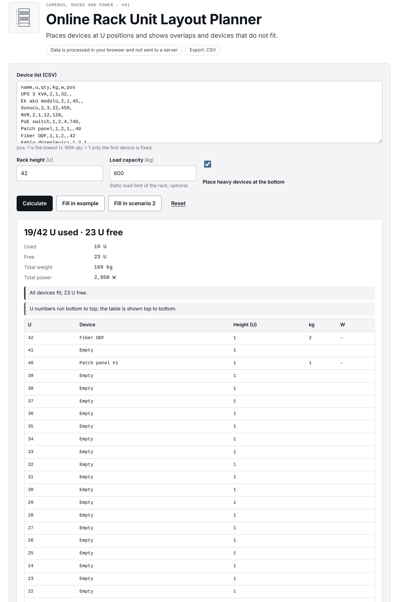

# Rack Unit Layout Planner

Create a rack layout from a device list (CSV): fixed positions, heavy-to-light automatic placement, free U, total weight and power; shows overlaps and overflow.

## Try it live

- [Türkçe](https://kamera.eretek.com/araclar/rack-u-yerlesimi)
- [English](https://kamera.eretek.com/en/tools/rack-layout-planner)
- [Deutsch](https://kamera.eretek.com/de/werkzeuge/rack-belegungsplaner)



## What it does

Places devices at U positions and shows overlaps and devices that do not fit.

If rules such as 'UPS at the bottom, patch panel at the top' are forgotten when rack installation starts on site, you end up removing and refitting. The tool places devices with a fixed position (pos), stacks the rest from the bottom optionally heaviest first and returns the rack view as a top-to-bottom table.

## Where it helps

Check total power in the PDU and UPS tools and device depth and cable direction in vendor drawings. Heed the warning about devices over 25 kg in the upper half.

## How to use it

1. CSV header: `name, u` required; `qty, kg, w, pos` optional (pos = lowest U of the device).
2. Enter rack height and load capacity; choose whether heavy devices go to the bottom.
3. Press Run; download the layout as CSV.

### Fields

| Field | Description |
|---|---|
| Device list (CSV) | pos: 1 is the lowest U. With qty > 1 only the first device is fixed. |
| Rack height |  |
| Load capacity | Static load limit of the rack; optional. |
| Place heavy devices at the bottom |  |

## Example input

Press **Fill in example** in the tool to load this input.

| Input | Value |
|---|---|
| Rack height | `42` |
| Load capacity | `600` |
| Place heavy devices at the bottom | `yes` |

**Device list (CSV)**

```text
name,u,qty,kg,w,pos
UPS 3 kVA,2,1,32,,
Ek akü modülü,2,1,45,,
Sunucu,2,3,22,450,
NVR,2,1,12,120,
PoE switch,1,2,4,740,
Patch panel,1,2,1,,40
Fiber ODF,1,1,2,,42
Kablo düzenleyici,1,2,1,,
```

**Expected result:** 19 U used, 23 U free; battery module 1–2, UPS 3–4, servers 5–10, NVR 11–12, switches 13–14; patch panel at 40 and ODF at 42 fixed; total 169 kg, 2,950 W.

## Method and assumptions

Devices with pos are placed first (overlap or outside the rack is an error). The rest are sorted by weight if chosen and placed from the bottom in the first free run of enough consecutive U.

## Limits and common mistakes

- Device depth, front/rear mounting, 0U PDUs and airflow direction are not modelled.

## Run it locally

The tool is plain HTML, CSS and JavaScript with no build step and no dependencies.

```bash
git clone https://github.com/eretek/rack-layout-planner.git
cd rack-layout-planner
node scripts/serve.js        # or: python3 -m http.server 8080
```

Open <http://127.0.0.1:8080/>. Add `?lang=tr` or `?lang=de` for Turkish or German; without it the page follows the browser language and falls back to English. You can also open `index.html` directly from disk.

Run the tests (Node.js 18 or later):

```bash
node test/run.js    # or: npm test
```

The tests run the tool's own fixtures and the worked examples in all three languages without a browser.

## How it works

All processing happens in your browser. The tool makes no network requests, uses no cookies or browser storage, and does not upload files you select.

No server-side component is needed. The version on the Eretek website renders the same page through a private WordPress plugin; that plugin only produces the page markup and is not part of this repository.

| Path | Purpose |
|---|---|
| `index.html` | Page shell |
| `src/app.js` | Builds the page in Turkish, English or German from `src/data.js` |
| `src/data.js` | Field definitions, examples and all texts in three languages |
| `src/core.js` | Shared runtime: validation, number formats, result rendering, CSV/ICS export |
| `src/tool.js` | The calculation or analysis for this tool |
| `docs/screenshot.png` | Screenshot used in this README |
| `src/tools.css`, `src/page.css` | Styles |
| `test/run.js`, `test/cases.json` | Headless tests |

## License and attribution

This tool is released under the [Eretek Website Attribution License](LICENSE). You may use, modify and redistribute it, including commercially. If you make it available on a website or web application, show a visible, clickable credit linking to https://eretek.com/ on every page where the tool is available, for example:

```html
<a href="https://eretek.com/">Powered by Eretek</a>
```

You may add `rel="nofollow"` to the link. Keep the copyright notice and license text in copies and redistributions.
